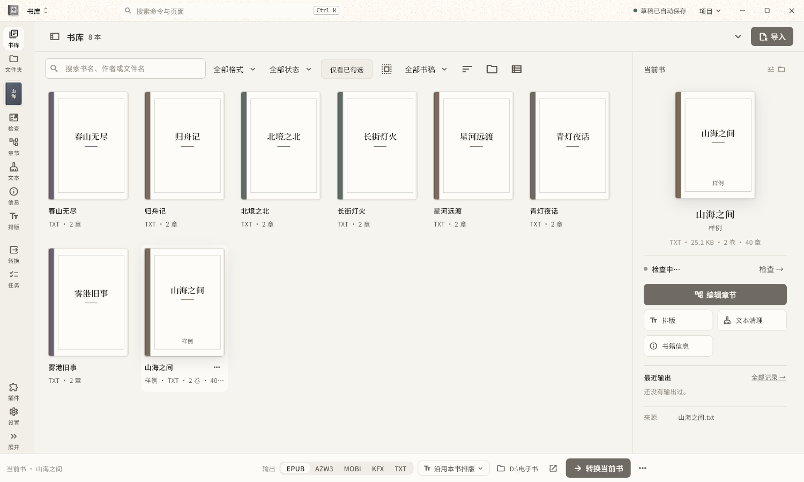
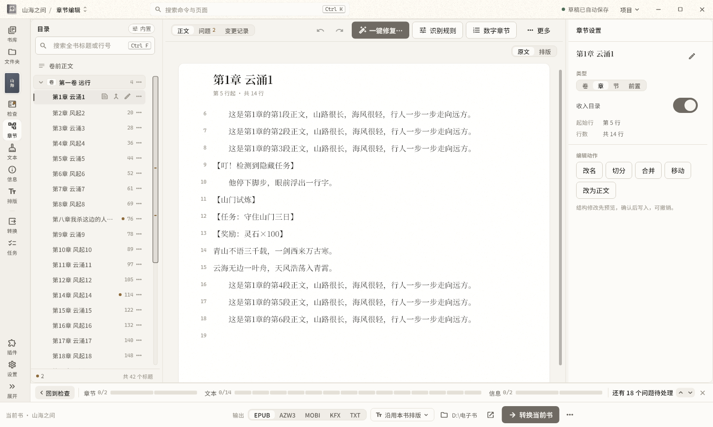
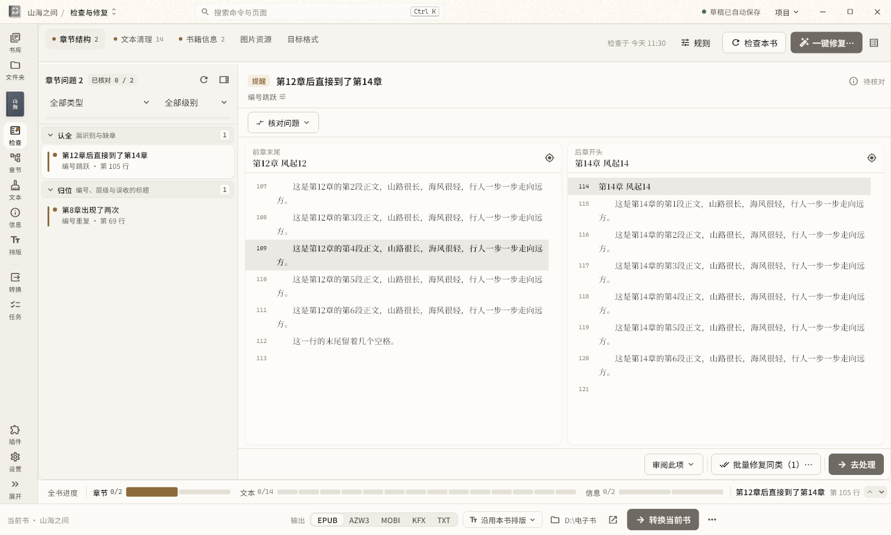
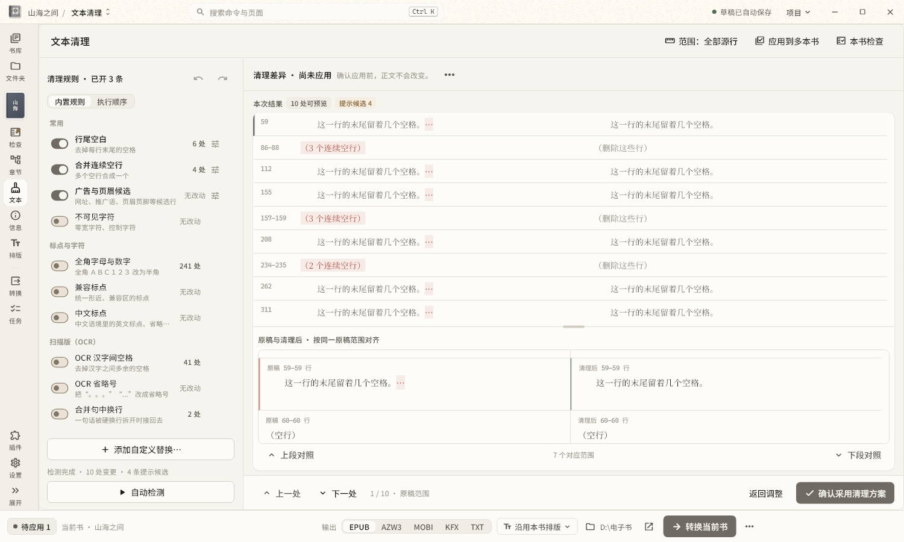
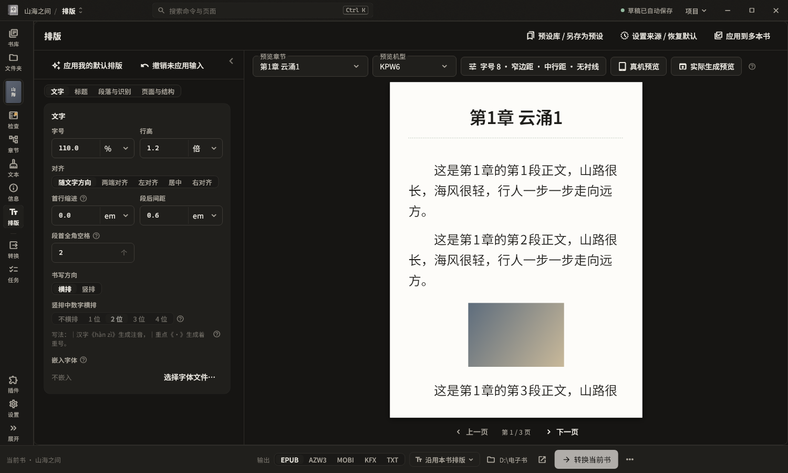
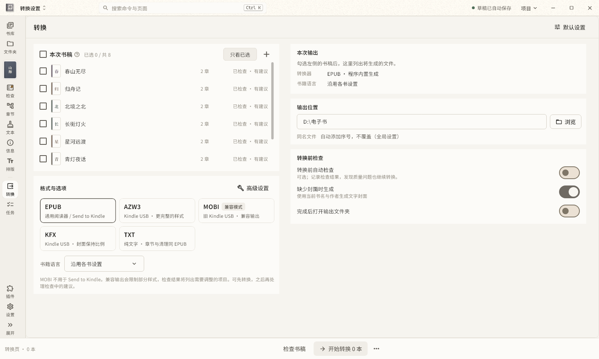
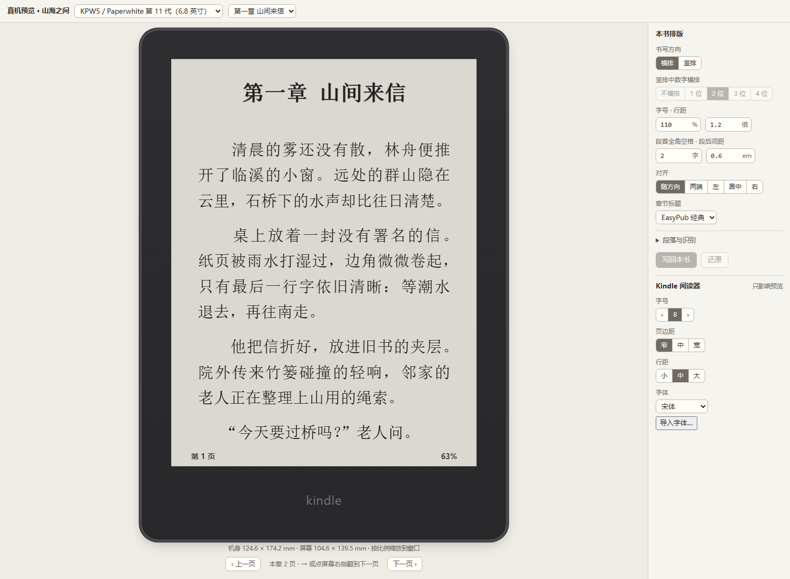

# easypub-lvy

Windows 上把小说整理成 Kindle 电子书的桌面工具。导入 TXT、EPUB、AZW3、MOBI，识别章节、检查修复、清理文字、排版，再生成 EPUB、AZW3、MOBI、KFX 或 TXT。

**当前版本：测试版 10**。下载请到 [Releases](https://github.com/uiu8/easypub-lvy/releases/latest)。



## 主要功能

| 功能 | 说明 |
| --- | --- |
| 导入 | TXT 自动判断编码，也能手动选 GBK、GB18030、Big5、Shift_JIS、EUC-KR；EPUB 和没有 DRM 的 AZW3、MOBI 会保留粗体、斜体、链接、脚注和表格 |
| 章节 | 自动识别卷、章、节，查出编号跳跃、重复标题、漏识别，先预览再修复，能一键修复 |
| 检查 | 按章节、文本、书籍信息分类列出问题，底部进度条跟着走，点问题直达要改的地方 |
| 文本清理 | 去广告、合并空行、规范标点、简繁转换，每条规则单独开关，原稿不改 |
| 排版 | 字号、行高、页边距、缩进和段后支持 px/pt/em/%，行高另支持倍数；标题样式、章首图、场景分隔，系统提示框和诗词自动识别，弹出注释，嵌入字体，图片压缩；生僻字注音默认关闭，可手动开启 |
| 真机预览 | 按 Kindle 机型的真实尺寸翻页看成品，12 款机型按各自固件的字号、边距、行距和页脚 |
| 保持原格式 | EPUB 可以直接用原书排版，并能去除原书字体和样式、改目录和起始位置 |
| 输出 | EPUB（2 或 3）、AZW3 和 MOBI（内置 Kindling）、KFX（内置 Bokai）、TXT；KFX/AZW3 可选书籍（EBOK，默认）或个人文档（PDOC） |
| 书源下载 | 可选插件，导入文字书源后搜索并下载成 TXT，单独发布 |

## 界面

**章节**：识别结果和正文并排，左侧标出有问题的章节。



**检查与修复**：按怎么处理分类，前后两章对照着看。



**文本清理**：每条规则改了哪里，清理前后逐处对照，确认才写入。



**排版**：改设置马上看到书页效果，支持夜间主题。



**转换**：一次选多本书，选格式和输出位置。



**真机预览**：按 Kindle 机型的真实尺寸翻页看成品。



## 使用

1. 从 [Releases](https://github.com/uiu8/easypub-lvy/releases/latest) 下载 `…-setup-r2.exe` 安装版，按提示安装；也可以下载 ZIP 便携版，完整解压后运行 `easypub_desktop.exe`。
2. 安装版按当前用户安装，支持开始菜单、可选桌面快捷方式和卸载。书库、设置和用户安装的插件在卸载时保留。
3. 书源下载为可选插件：可在安装时勾选，也可下载独立的 `easypub-lvy-booksource-…zip`，解压后在软件“插件 → 从文件夹安装”选择 `booksource` 文件夹，再启用。已有插件会保留，无需重装。
4. 安装版与便携版使用相同的自动更新。安装程序目前尚未进行 Windows 发布者证书签名。
5. 担心 Kindle 联网同步删除自己传入的书，可在 KFX/AZW3 转换设置中选择 PDOC；不保证完全避免删除。该选项只改内容分类，不改排版，也不会上传书籍。

## 开发

| 目录 | 内容 |
| --- | --- |
| `rust/crates/` | `easypub_core`（编码、识别、规则）、`easypub_app`（书稿、检查修复、排版、EPUB 输出）、`easypub_bridge`（给 Flutter 的接口） |
| `flutter/` | 桌面界面；测试在 `flutter/test/` |
| `plugins/kindle-preview/` | 真机预览插件 |
| `third_party/` | 内置的 Kindling（AZW3 / MOBI）、Bokai（KFX）补丁与固定版本的依赖源码 |
| `samples/`、`fixtures/` | 测试用的合成样书 |
| `tools/` | 环境、测试与打包脚本 |

需要：Rust 1.98.1（见 `rust-toolchain.toml`）、Flutter 3.47.3、flutter_rust_bridge 2.13.0、Visual Studio C++ 生成工具。`tools/project_env.ps1` 里的工具链目录是作者本机的，请按自己的安装位置修改。

```powershell
cargo build --release -p easypub_bridge
cd flutter
flutter build windows --release --target lib/frontend_rewrite_main.dart --no-tree-shake-icons
copy ..\target\release\easypub_bridge.dll build\windows\x64\runner\Release\
```

生产入口是 `lib/frontend_rewrite_main.dart`，构建时必须显式指定。

## 许可证

本项目自己的代码以 [MIT 许可证](LICENSE) 发布。

`third_party/` 下的组件各按自己的许可证：Kindling 为 MIT；Bokai 为 GPL-3.0-or-later，只作为独立的 `bokai.exe` 由程序调用，发布包附带其源码；其余依赖见各目录内的许可证文件。发布包里的转换器、字体和依赖许可证在压缩包的 `third_party/` 与 `converters/` 目录中。
